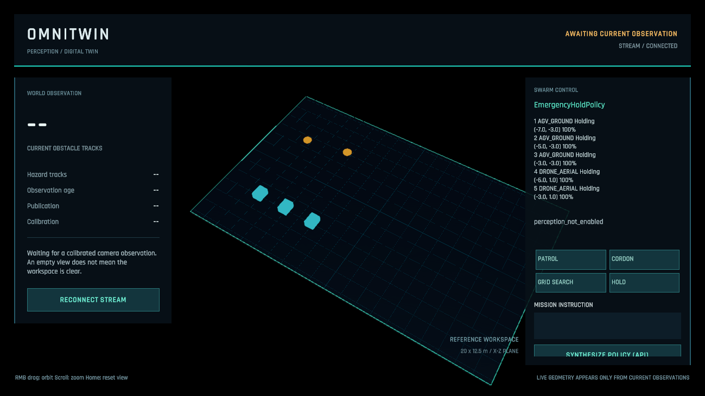

# OmniTwin

OmniTwin maps camera pixels onto a calibrated simulation plane and defines immutable world, agent, mission, and policy contracts. Its perception tools decode SAM 3.1 masks into estimated world footprints and session-stable tracks. A local ASP.NET Core host publishes validated tracking snapshots over a bounded WebSocket stream.

The Windows desktop implementation includes hybrid OpenCV/SAM tracking, four deterministic policies, three NavMesh ground vehicles, two aerial agents, measured simulation telemetry, path rendering, and a UI Toolkit command HUD. Brain synthesizes C# through Baseten, verifies semantic symbols with Roslyn, and runs generated policies exclusively in a capability-free Windows AppContainer with a resource-limited Job Object. Unity receives validated directives, never generated executable code. Physical camera/model access and a complete live tabletop demonstration still require verification with the user's hardware and credentials.



The screenshot shows the actual scene, five measured simulation agents and `EmergencyHoldPolicy` with perception disabled. Unavailable obstacle counters are not a claim that the workspace is clear. [Open and run the integrated scene](docs/unity-scene.md).

The [project audit](docs/project-audit.md) separates implemented modules from outstanding hardware/product acceptance. The [API key guide](docs/api-keys.md) covers masked local setup of both `META_API_KEY` and `BASETEN_API_KEY`. Model synthesis starts only after an explicit HUD command; normal baseline missions do not invoke Baseten.

The operator HUD also supports short microphone commands through **Muse Voice Transcribe** and an opt-in camera PIP from the existing capture pipeline. Transcripts remain editable drafts; manual text is preserved while transcription runs. No microphone opens at startup. Preview images expire independently and do not establish navigation trust. [Voice/preview setup, limits and verification](docs/operator-media.md).

## Build and verify

Install [.NET SDK 10.0.403](https://dotnet.microsoft.com/en-us/download/dotnet/10.0) (or a newer stable patch in its 10.0.4xx feature band). The SDK includes the .NET/ASP.NET Core runtime. `global.json` pins this SDK feature band and rejects previews and unreviewed major upgrades. NuGet access is needed for the initial restore; no API credentials or camera are needed for these checks.

From the directory containing `OmniTwin.sln`:

```powershell
dotnet restore OmniTwin.sln --locked-mode
dotnet build OmniTwin.sln -c Release --no-restore
dotnet test --solution OmniTwin.sln -c Release --no-build --no-restore
```

Contracts, Perception, Transport, and Policies build for `net10.0` and `netstandard2.1`. Two .NET 10 hosts test both library targets. Further suites exercise native OpenCV, real Kestrel HTTP/WebSockets, Baseten protocol handling, Roslyn, actual AppContainer permissions, and hard termination of generated loops. Windows with a .NET 10 runtime in `Program Files/dotnet` is required for isolated execution tests. No provider credentials or physical camera are used. NuGet pins and lock files are committed. [Version policy](docs/dependencies.md), [executed checks and limits](docs/verification.md).

See [verification results](docs/verification.md) for the checks actually run and their limits.

## Implemented modules

| Location | Responsibility |
| --- | --- |
| `src/OmniTwin.Contracts` | Finite X/Z vectors, obstacles, telemetry, missions, policy contracts, and session/calibration-scoped tracking snapshots |
| `src/OmniTwin.Perception/Calibration` | Pixel coordinates, homography, and convex camera/world workspace checks |
| `src/OmniTwin.Perception/Vision` | Frame-change scheduling and bounded canonical one_bit mask decoding |
| `src/OmniTwin.Perception/Tracking` | Global gated association, bounded motion prediction, monotonic expiry, and confidence decay |
| `src/OmniTwin.Perception.Runtime` | OpenCV capture, SAM client, strict calibration loading, mask projection, and independent tracking publication |
| `src/OmniTwin.Perception/Audio` | Bounded PCM16 WAV, stereo mixdown and filtered resampling for voice commands |
| `src/OmniTwin.Perception.Runtime/Audio` | Real Muse Voice multipart adapter, strict transcript parsing, deadlines and safe failures |
| `src/OmniTwin.Backend/Media` | Capture preview cache, same-origin media endpoints and bounded transcription deduplication |
| `src/OmniTwin.Transport` | Closed-schema codec, order guard, bounded receiver, reconnecting single-producer client, atomic latest-state handoff, and source/track freshness checks |
| `src/OmniTwin.Backend` | Loopback host, source supervision, health/status/latest endpoints, and bounded per-client WebSocket publication |
| `src/OmniTwin.Policies` | Perimeter patrol, hazard quarantine, grid search, emergency hold, swept-footprint checks and bounded A* waypoints |
| `src/OmniTwin.Brain` | Baseten 404-only model alias fallback, semantic compiler, three-attempt self-repair, AppContainer/Job supervision |
| `src/OmniTwin.PolicyWorker` | Trusted IPC worker; generated assembly loading occurs only after an AppContainer token check |
| `src/OmniTwin.Perception.Cli` | Capture, local JPEG snapshots, inference/tracking tools, and a validated `stream-probe` client |
| `unity/client/Runtime` | Desktop network, navigation, fail-safe controls, opt-in camera texture and operator-initiated microphone capture |
| `tools/InstallUnityClient.ps1` | Imports portable DLLs and Unity scripts into an existing project while protecting local edits and `.meta` files |
| `tests/OmniTwin.Tests` | Geometry, numerical boundaries, concurrency, collection ownership, constructor validation, and JSON round trips |
| `tests/OmniTwin.NetStandard.Tests` | Runs the shared tests against the .NET Standard assemblies |
| `tests/OmniTwin.Perception.Runtime.Tests` | HTTP failure handling, wire parsing, native image processing, stale-result rejection, and queue coalescing |
| `tests/OmniTwin.Backend.Tests` | Broker backpressure, source failure, client limits, shutdown, close handshakes, origin policy, and real HTTP/WebSocket transport |
| `tests/OmniTwin.Brain.Tests` | Model protocol/repair fixtures, semantic capability rejection, actual OS isolation, timeout/memory/nonfinite-output checks |

Snapshots own collections and reject null entries, duplicate IDs, nonfinite coordinates, invalid enums and ranges. WorldState/mission/control schemas remain version 1; obstacle tracking and its WebSocket envelope use version 2 for provenance. Transport also enforces producer-session ordering, size limits and required JSON fields; DTO constructors alone are not a wire protocol validator.

`Vector2D.DistanceTo` returns `double` to avoid overflow when finite float components are far apart. Vector components have validated initialization accessors so `System.Text.Json` can reconstruct nonzero readonly values. Snapshot records contain owned read-only collections; record equality does not provide structural collection equality.

## Run perception tools

Inspect commands without opening a camera or making an API request:

```powershell
dotnet run --project src/OmniTwin.Perception.Cli -c Release -- --help
```

On Windows x64, inspect five seconds of local camera device 0. The output contains capture metadata and change measurements; frames are not saved:

```powershell
dotnet run --project src/OmniTwin.Perception.Cli -c Release -- capture 0 5
```

For inference, set `META_API_KEY` in the terminal's process environment. `.env.example` lists the configuration names; `.env` files are not loaded automatically. A still JPEG is validated, oriented, and re-encoded before submission. `watch` submits selected camera frames:

```powershell
dotnet run --project src/OmniTwin.Perception.Cli -c Release -- segment "frame.jpg" "cup"
dotnet run --project src/OmniTwin.Perception.Cli -c Release -- watch 0 30 "cup"
```

These two commands send images to Meta and can consume API credits. They require account access to `sam-3.1`. Use a single noun phrase per request. SAM response IDs identify objects within that response; independent image calls do not establish persistent obstacle identities. The tools output pixel geometry, not fused world obstacles.

The adapter requests non-streaming `one_bit` masks with confidence and validates the envelope, grammar, IDs, dimensions, confidence, allocation budgets and canonical mask. Queues retain one pending frame; inference is serial. SAM defaults to 6 seconds per attempt and 12 seconds per operation; a frame's remaining 12-second useful lifetime can cancel it earlier. [Detailed behavior](docs/perception.md).

## Track calibrated world obstacles

Validate the supplied mathematical example without opening hardware or calling an API:

```powershell
dotnet run --project src/OmniTwin.Perception.Cli -c Release -- calibration-check examples/calibration.rectangular.json
```

Create your own profile with the [four-point calibration workflow](docs/calibration.md): save a JPEG using `snapshot 0 local/table.jpg`, start the disabled-perception backend, and open `/calibration`. The page keeps the JPEG in the browser and submits only profile JSON for strict server-side geometry validation. Download the validated profile into the Git-ignored `local/` directory. Image, corner, or scale changes invalidate its download link.

Match the actual camera resolution and give each changed mapping a new calibration ID. The supplied rectangle is a configuration example; validation checks its geometry and schema, not the accuracy of a physical setup.

With your calibration file and `META_API_KEY`, publish world tracks while observing cups:

```powershell
dotnet run --project src/OmniTwin.Perception.Cli -c Release -- watch-world 0 30 "cup" "calibration.json"
```

Add `--hazard` to designate this session's observed concept as hazardous. This flag is an operator setting, not inferred chemical classification. The tool checks camera resolution before submitting a frame.

`watch-world` projects the lower mask band, checks footprint clearance, and associates stable local IDs. Between SAM replies, sparse forward/backward optical flow updates measured local displacement. Publications distinguish `SamVerified` from `LocalMotionEstimate` and keep geometry age separate from SAM age. Verified retention is 20 seconds; local geometry and the camera heartbeat expire after 1 second. API/tracking failures invalidate movement. Publication targets 30 Hz; this is not a measured throughput guarantee. [Tracking semantics](docs/tracking.md).

## Start the local backend

From the repository root, start the host with perception explicitly disabled:

```powershell
dotnet run --project src/OmniTwin.Backend -c Release -- --OmniTwin:EnablePerception=false
```

The default address is `http://127.0.0.1:5108`. `/health/live` confirms the process is serving requests; `/api/status` describes perception state. Readiness and latest-world return HTTP 503 until the required data is available. No camera or model request starts in this mode, and no fabricated world snapshot is generated.

After configuring `META_API_KEY` and your measured calibration file, enable the real pipeline in the terminal that starts the host:

```powershell
$env:OmniTwin__CalibrationPath = (Resolve-Path .\calibration.json).Path
$env:OmniTwin__EnablePerception = "true"
dotnet run --project src/OmniTwin.Backend -c Release
```

In another terminal, receive three validated publications:

```powershell
dotnet run --project src/OmniTwin.Perception.Cli -c Release -- stream-probe ws://127.0.0.1:5108/ws/twin 3
```

`/ws/twin` requires subprotocol `omnitwin.v2` (breaking provenance update). Each client has one pending snapshot slot and its own send deadline. Source failure clears cached publications. Separate `/api/swarm/telemetry`, `/api/swarm/mission`, and `/api/swarm/status` endpoints carry actual agent measurements, commands and correlated directives. [Backend protocol](docs/backend.md), [swarm and Brain](docs/brain.md).

## Calibrate a plane

Provide four image corners in perimeter order and the four matching physical corners in world coordinates. For an axis-aligned example:

```csharp
using OmniTwin.Contracts;
using OmniTwin.Perception.Calibration;

var mapper = new HomographyMapper(
    new[] {
        new PixelPoint(0, 0), new PixelPoint(639, 0),
        new PixelPoint(639, 479), new PixelPoint(0, 479)
    },
    new[] {
        new Vector2D(-10, -6.25f), new Vector2D(10, -6.25f),
        new Vector2D(10, 6.25f), new Vector2D(-10, 6.25f)
    });

Vector2D center = mapper.PixelToWorld(319.5, 239.5); // X = 0, Z = 0
if (mapper.TryPixelToWorld(159.75, 119.75, out Vector2D position))
{
    // Consume the valid result: X = -5, Z = -3.125.
    System.Console.WriteLine($"X={position.X}, Z={position.Z}");
}
```

The mapper normalizes both point sets, solves a homogeneous system with complete pivoting, checks its fit, and rejects invalid corner geometry. Its mapping methods use immutable state without I/O, locks, or heap allocations. Construct a new instance for recalibration and publish that reference atomically; input collections must remain stable during construction.

Projection failure throws from `PixelToWorld` or returns `false` from `TryPixelToWorld`. Ignore the out value on failure. Queries outside the calibration polygon are extrapolated; workspace checks are the caller's responsibility, and precision is not guaranteed far outside the calibrated region.

The mapping describes a plane, with world Y chosen separately by the simulation. It does not estimate object height, undo lens distortion, establish an object's true contact point, or certify a collision-free destination. Details and corrected architectural assumptions are in [engineering decisions](docs/engineering-decisions.md).

## Unity boundary

The user-created **Unity 6000.6.3f1 / Universal 3D** project is in `unity/OmniTwin.Unity`. Open `Assets/_OmniTwin/Scenes/TacticalDesk.unity` and use the [scene guide](docs/unity-scene.md). The earlier [Polish setup guide](docs/unity-setup.md) remains a reference for creating a separate project.

The actual project already contains the imported client and wired scene. To update its portable DLLs or seed another compatible project, close that project's Editor and run:

```powershell
./tools/InstallUnityClient.ps1 -ProjectPath ./unity/OmniTwin.Unity
```

The installer selects resolved .NET Standard runtime dependencies through MSBuild; copying one transport DLL alone is insufficient. The scene already wires `TwinWebSocketClient`, `DynamicObstacleSpawner`, and the HUD. The installer also has filesystem checks for local-edit and asset-metadata protection. [Connection lifecycle and import details](docs/unity-client.md).

The `netstandard2.1` outputs are candidate Unity inputs; the runtime/host/CLI projects stay on the backend side:

```text
src/OmniTwin.Contracts/bin/Release/netstandard2.1/OmniTwin.Contracts.dll
src/OmniTwin.Perception/bin/Release/netstandard2.1/OmniTwin.Perception.dll
src/OmniTwin.Transport/bin/Release/netstandard2.1/OmniTwin.Transport.dll
```

Use externally compiled libraries rather than copying the C# 14 source into Unity's script compiler. Contracts and Perception have no third-party runtime packages. The .NET Standard Transport target references `System.Text.Json` 10.0.14 and its transitive packages; the .NET 10 target uses framework JSON support. Unity keeps its own supported scripting runtime; the .NET 10 backend runs separately over WebSockets. Editor import and JSON validation were exercised on Unity's Mono runtime. IL2CPP stripping/AOT, standalone builds, camera-driven navigation, and sustained performance remain unverified. The decoder does not use Unity `JsonUtility`.

Generated policies run only in the Windows worker, without inherited API keys or network capabilities, under memory/process/CPU/wall limits. Syntax/semantic verification is defense in depth, not the isolation boundary. A failed policy selects the requested built-in mission; untrusted perception or stale control selects `EmergencyHoldPolicy`. The HUD displays the actual model ID, 404 fallback, bounded diagnostics and a concise public decision summary. [Execution boundary and limits](docs/brain.md).

The adapted one_bit codec and its conformance fixtures are distributed under the [SAM License](third-party/meta-sam/LICENSE); see [provenance and attribution](third-party/meta-sam/NOTICE.md).
