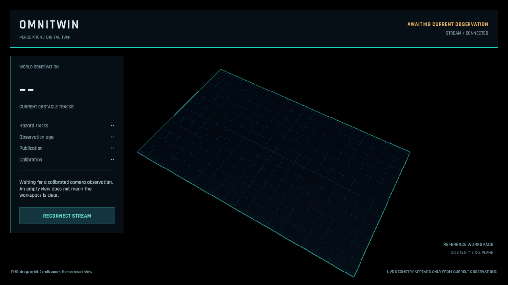

# OmniTwin

OmniTwin maps camera pixels onto a calibrated simulation plane and defines immutable world, agent, mission, and policy contracts. Its perception tools decode SAM 3.1 masks into estimated world footprints and session-stable tracks. A local ASP.NET Core host publishes validated tracking snapshots over a bounded WebSocket stream.

The camera/SAM adapter, calibration, footprint estimation, tracking, local host, and portable stream client are implemented. The Unity 6.6 project includes a tactical scene, an observed-footprint visualizer, a baked reference-floor NavMesh, orbit/zoom controls, and a UI Toolkit status HUD. Play-mode progression, the real local backend connection, HUD reconnect interaction, and portable JSON operation inside Unity have been checked. Live camera/Meta API operation, observed-obstacle navigation, agent behavior, Baseten planning, and generated-policy execution remain unverified or subsequent work.



The screenshot shows the actual scene with perception disabled. Empty counters indicate unavailable observations; no detections or agents are fabricated. [Open and run the integrated scene](docs/unity-scene.md).

## Build and verify

Install [.NET SDK 10.0.403](https://dotnet.microsoft.com/en-us/download/dotnet/10.0) (or a newer stable patch in its 10.0.4xx feature band). The SDK includes the .NET/ASP.NET Core runtime. `global.json` pins this SDK feature band and rejects previews and unreviewed major upgrades. NuGet access is needed for the initial restore; no API credentials or camera are needed for these checks.

From the directory containing `OmniTwin.sln`:

```powershell
dotnet restore OmniTwin.sln --locked-mode
dotnet build OmniTwin.sln -c Release --no-restore
dotnet test --solution OmniTwin.sln -c Release --no-build --no-restore
```

The solution builds Contracts, Perception, and Transport for `net10.0` and `netstandard2.1`. Two .NET 10 test hosts execute shared core/transport tests against those targets and verify the loaded framework attributes. Further suites test native JPEG/perception adapters and a real Kestrel HTTP/WebSocket host on ephemeral loopback ports. No model credentials or physical camera are used in the tests. NuGet versions are centralized in `Directory.Packages.props`; committed lock files capture transitive dependencies. The Windows GitHub Actions workflow runs locked restore, build, tests, and CLI checks. [Version policy and sources](docs/dependencies.md).

See [verification results](docs/verification.md) for the checks actually run and their limits.

## Implemented modules

| Location | Responsibility |
| --- | --- |
| `src/OmniTwin.Contracts` | Finite X/Z vectors, obstacles, telemetry, missions, policy contracts, and session/calibration-scoped tracking snapshots |
| `src/OmniTwin.Perception/Calibration` | Pixel coordinates, homography, and convex camera/world workspace checks |
| `src/OmniTwin.Perception/Vision` | Frame-change scheduling and bounded canonical one_bit mask decoding |
| `src/OmniTwin.Perception/Tracking` | Global gated association, bounded motion prediction, monotonic expiry, and confidence decay |
| `src/OmniTwin.Perception.Runtime` | OpenCV capture, SAM client, strict calibration loading, mask projection, and independent tracking publication |
| `src/OmniTwin.Transport` | Closed-schema codec, order guard, bounded receiver, reconnecting single-producer client, atomic latest-state handoff, and source/track freshness checks |
| `src/OmniTwin.Backend` | Loopback host, source supervision, health/status/latest endpoints, and bounded per-client WebSocket publication |
| `src/OmniTwin.Perception.Cli` | Capture/inference/tracking tools and a validated `stream-probe` client |
| `unity/client/Runtime` | Desktop Unity worker adapter and main-thread observed-footprint visualizer with navigation obstacles |
| `tools/InstallUnityClient.ps1` | Imports portable DLLs and Unity scripts into an existing project while protecting local edits and `.meta` files |
| `tests/OmniTwin.Tests` | Geometry, numerical boundaries, concurrency, collection ownership, constructor validation, and JSON round trips |
| `tests/OmniTwin.NetStandard.Tests` | Runs the shared tests against the .NET Standard assemblies |
| `tests/OmniTwin.Perception.Runtime.Tests` | HTTP failure handling, wire parsing, native image processing, stale-result rejection, and queue coalescing |
| `tests/OmniTwin.Backend.Tests` | Broker backpressure, source failure, client limits, shutdown, close handshakes, origin policy, and real HTTP/WebSocket transport |

Snapshots copy incoming collections and reject null elements and duplicate IDs. Scalar validation rejects nonfinite coordinates, invalid enum values, negative IDs, and invalid ranges. Snapshot sequence numbers and schema version 1 are represented explicitly. Transport additionally enforces producer-session ordering, size limits, required JSON fields, and schema validation; DTO constructors alone are not a wire protocol validator.

`Vector2D.DistanceTo` returns `double` to avoid overflow when finite float components are far apart. Vector components have validated initialization accessors so `System.Text.Json` can reconstruct nonzero readonly values. Snapshot records contain owned read-only collections; record equality does not provide structural collection equality.

## Run perception tools

Inspect commands without opening a camera or making an API request:

```powershell
dotnet run --project src/OmniTwin.Perception.Cli -c Release -- --help
```

On Windows x64, inspect five seconds of local camera device 0. The output contains capture metadata and change measurements; frames are not saved:

```powershell
dotnet run --project src/OmniTwin.Perception.Cli -c Release -- capture 0 5
```

For inference, set `META_API_KEY` in the terminal's process environment. `.env.example` lists the configuration names; `.env` files are not loaded automatically. A still JPEG is validated, oriented, and re-encoded before submission. `watch` submits selected camera frames:

```powershell
dotnet run --project src/OmniTwin.Perception.Cli -c Release -- segment "frame.jpg" "cup"
dotnet run --project src/OmniTwin.Perception.Cli -c Release -- watch 0 30 "cup"
```

These two commands send images to Meta and can consume API credits. They require account access to `sam-3.1`. Use a single noun phrase per request. SAM response IDs identify objects within that response; independent image calls do not establish persistent obstacle identities. The tools output pixel geometry, not fused world obstacles.

The adapter requests non-streaming `one_bit` masks with confidence and validates the completed response envelope, grammar, IDs, dimensions, confidence agreement, allocation budgets, and canonical decoded mask. Pending capture/segmentation queues each retain one frame; an active request runs serially. Results older than five seconds are reported as `stale_result` with no detections published. Failures produce sanitized categories; camera capture continues through API failures. [Detailed behavior and limits](docs/perception.md).

## Track calibrated world obstacles

Validate the supplied mathematical example without opening hardware or calling an API:

```powershell
dotnet run --project src/OmniTwin.Perception.Cli -c Release -- calibration-check examples/calibration.rectangular.json
```

Create your own calibration JSON using that file's schema and four measured camera/workspace correspondences. Match the actual camera resolution and give each changed mapping a new calibration ID. The supplied rectangle is a configuration example; validation checks its geometry and schema, not the accuracy of a physical setup.

With your calibration file and `META_API_KEY`, publish world tracks while observing cups:

```powershell
dotnet run --project src/OmniTwin.Perception.Cli -c Release -- watch-world 0 30 "cup" "calibration.json"
```

Add `--hazard` to designate this session's observed concept as hazardous. This flag is an operator setting, not inferred chemical classification. The tool checks camera resolution before submitting a frame.

`watch-world` estimates a circular footprint from the lower mask band, checks its clearance against the workspace, and assigns local IDs using world-space motion and radius gates. Publication runs independently of inference, with a nominal 30 Hz timer and three-second retention. Each JSON snapshot contains session/calibration identity, publication/source sequences, source age/currentness, and track age/confidence. A future consumer can distinguish a fresh empty observation from a stream whose observations have expired. Geometry stays at its last observed position between detections. [Tracking semantics and limits](docs/tracking.md).

## Start the local backend

From the repository root, start the host with perception explicitly disabled:

```powershell
dotnet run --project src/OmniTwin.Backend -c Release -- --OmniTwin:EnablePerception=false
```

The default address is `http://127.0.0.1:5108`. `/health/live` confirms the process is serving requests; `/api/status` describes perception state. Readiness and latest-world return HTTP 503 until the required data is available. No camera or model request starts in this mode, and no fabricated world snapshot is generated.

After configuring `META_API_KEY` and your measured calibration file, enable the real pipeline in the terminal that starts the host:

```powershell
$env:OmniTwin__CalibrationPath = (Resolve-Path .\calibration.json).Path
$env:OmniTwin__EnablePerception = "true"
dotnet run --project src/OmniTwin.Backend -c Release
```

In another terminal, receive three validated publications:

```powershell
dotnet run --project src/OmniTwin.Perception.Cli -c Release -- stream-probe ws://127.0.0.1:5108/ws/twin 3
```

`/ws/twin` requires subprotocol `omnitwin.v1`. Each client has one pending snapshot slot and its own send deadline. A slow client cannot make the producer wait for network I/O. Source failure clears the latest cache and closes existing streams. [Backend configuration and wire protocol](docs/backend.md).

## Calibrate a plane

Provide four image corners in perimeter order and the four matching physical corners in world coordinates. For an axis-aligned example:

```csharp
using OmniTwin.Contracts;
using OmniTwin.Perception.Calibration;

var mapper = new HomographyMapper(
    new[] {
        new PixelPoint(0, 0), new PixelPoint(640, 0),
        new PixelPoint(640, 480), new PixelPoint(0, 480)
    },
    new[] {
        new Vector2D(-10, -6.25f), new Vector2D(10, -6.25f),
        new Vector2D(10, 6.25f), new Vector2D(-10, 6.25f)
    });

Vector2D center = mapper.PixelToWorld(320, 240); // X = 0, Z = 0
if (mapper.TryPixelToWorld(160, 120, out Vector2D position))
{
    // Consume the valid result: X = -5, Z = -3.125.
    System.Console.WriteLine($"X={position.X}, Z={position.Z}");
}
```

The mapper normalizes both point sets, solves a homogeneous system with complete pivoting, checks its fit, and rejects invalid corner geometry. Its mapping methods use immutable state without I/O, locks, or heap allocations. Construct a new instance for recalibration and publish that reference atomically; input collections must remain stable during construction.

Projection failure throws from `PixelToWorld` or returns `false` from `TryPixelToWorld`. Ignore the out value on failure. Queries outside the calibration polygon are extrapolated; workspace checks are the caller's responsibility, and precision is not guaranteed far outside the calibrated region.

The mapping describes a plane, with world Y chosen separately by the simulation. It does not estimate object height, undo lens distortion, establish an object's true contact point, or certify a collision-free destination. Details and corrected architectural assumptions are in [engineering decisions](docs/engineering-decisions.md).

## Unity boundary

The user-created **Unity 6000.6.3f1 / Universal 3D** project is in `unity/OmniTwin.Unity`. Open `Assets/_OmniTwin/Scenes/TacticalDesk.unity` and use the [scene guide](docs/unity-scene.md). The earlier [Polish setup guide](docs/unity-setup.md) remains a reference for creating a separate project.

The actual project already contains the imported client and wired scene. To update its portable DLLs or seed another compatible project, close that project's Editor and run:

```powershell
./tools/InstallUnityClient.ps1 -ProjectPath ./unity/OmniTwin.Unity
```

The installer selects resolved .NET Standard runtime dependencies through MSBuild; copying one transport DLL alone is insufficient. The scene already wires `TwinWebSocketClient`, `DynamicObstacleSpawner`, and the HUD. The installer also has filesystem checks for local-edit and asset-metadata protection. [Connection lifecycle and import details](docs/unity-client.md).

The `netstandard2.1` outputs are candidate Unity inputs; the runtime/host/CLI projects stay on the backend side:

```text
src/OmniTwin.Contracts/bin/Release/netstandard2.1/OmniTwin.Contracts.dll
src/OmniTwin.Perception/bin/Release/netstandard2.1/OmniTwin.Perception.dll
src/OmniTwin.Transport/bin/Release/netstandard2.1/OmniTwin.Transport.dll
```

Use externally compiled libraries rather than copying the C# 14 source into Unity's script compiler. Contracts and Perception have no third-party runtime packages. The .NET Standard Transport target references `System.Text.Json` 10.0.14 and its transitive packages; the .NET 10 target uses framework JSON support. Unity keeps its own supported scripting runtime; the .NET 10 backend runs separately over WebSockets. Editor import and JSON validation were exercised on Unity's Mono runtime. IL2CPP stripping/AOT, standalone builds, camera-driven navigation, and sustained performance remain unverified. The decoder does not use Unity `JsonUtility`.

`ISwarmPolicy` is only a contract in this module. The [constitution](AGENTS.md) requires isolated execution of generated policies and validated directives at the Unity boundary. There is no dynamic-code loader or claimed sandbox in this release.

The adapted one_bit codec and its conformance fixtures are distributed under the [SAM License](third-party/meta-sam/LICENSE); see [provenance and attribution](third-party/meta-sam/NOTICE.md).
