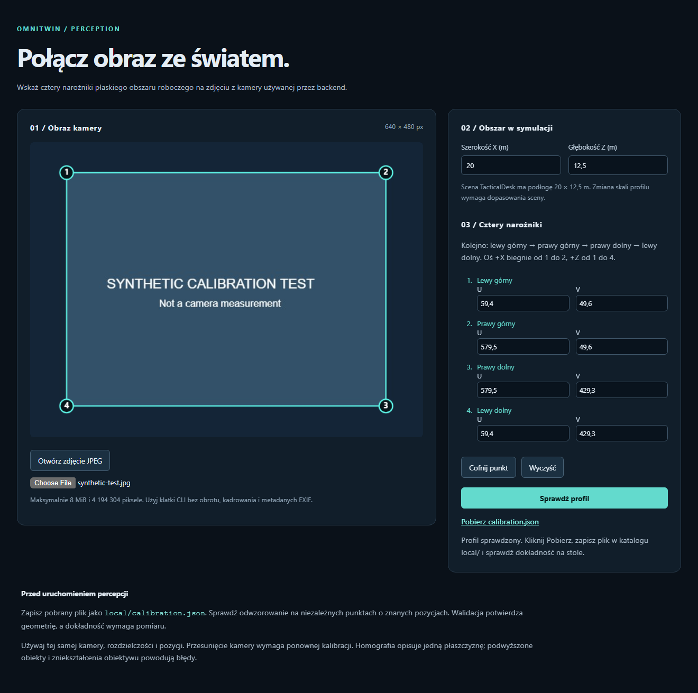

# Kalibracja kamery

Polecenia wykonuj z katalogu zawierającego `OmniTwin.sln`, używając SDK wskazanego w `global.json`. Scena Unity `TacticalDesk` ma podłogę 20 × 12,5 m. Ten etap nie wymaga zmian pakietów Unity.

Systemowy SDK 10.0.401 na tej maszynie jest starszy od przypiętego 10.0.403. Zainstaluj 10.0.403 lub nowszą stabilną poprawkę z pasma 10.0.4xx przed użyciem zwykłego `dotnet run`. Weryfikację w tej sesji wykonano przy użyciu osobnego lokalnego SDK 10.0.403; projekt nie obniża wymaganej wersji.

## Zapisz klatkę tej samej kamery

Unieruchom kamerę i zaznacz cztery narożniki prostokątnego obszaru na jednej płaskiej powierzchni. Przykładowo fizyczne 80 × 50 cm może odpowiadać 20 × 12,5 m w symulacji: 25 metrów świata na metr stołu. Profil opisuje metry **symulacji**.

Zatrzymaj percepcję i inne programy korzystające z kamery, a następnie:

```powershell
dotnet run --project src/OmniTwin.Perception.Cli -c Release -- snapshot 0 local/table.jpg
```

`0` oznacza indeks kamery. Polecenie używa tego samego modułu OpenCV co percepcja, żąda 640 × 480 i wypisuje faktycznie otrzymane wymiary. Zapisuje jeden JPEG bez EXIF. Nie wywołuje API. Nie nadpisuje istniejącego pliku; przy powtórzeniu użyj np. `local/table-2.jpg`. Końcowy zapis następuje po zamknięciu źródła i ukończeniu pliku tymczasowego; konkurencyjny zapis również nie nadpisze zdjęcia.

Budżet anulowania wynosi 15 sekund. Natywnego wywołania sterownika OpenCV nie można siłowo przerwać, więc wadliwy sterownik może opóźnić zamknięcie. Ctrl+C anuluje operacje zarządzane. Pierwsze zdjęcie może wymagać powtórzenia po ustabilizowaniu ekspozycji.

Katalog `local/` jest ignorowany przez Git. Przechowuj tam własne zdjęcia i profile; nie dodawaj ich wymuszeniem do repozytorium.

## Wybierz cztery narożniki

W osobnym terminalu uruchom lokalny backend:

```powershell
dotnet run --project src/OmniTwin.Backend -c Release -- --OmniTwin:EnablePerception=false
```

Otwórz [kalibrator](http://127.0.0.1:5108/calibration). Klucz Meta nie jest potrzebny.

1. Otwórz zapisany JPEG. Zdjęcie pozostaje w przeglądarce. Nie zmieniaj kadrowania, obrotu ani rozdzielczości.
2. Pozostaw 20 × 12,5 m dla obecnej sceny. Inna skala wymaga dopasowania podłogi i nawigacji w Unity.
3. Kliknij kolejno: lewy górny, prawy górny, prawy dolny, lewy dolny narożnik obszaru. Wybieraj punkty płaszczyzny stołu. Dla obróconego obszaru zachowaj kolejność obwodu i świadomie wybierz osie: +X od punktu 1 do 2, +Z od 1 do 4.
4. Możesz cofnąć punkt, wyczyścić wybór lub poprawić U/V liczbowo. To piksele oryginalnego zdjęcia, niezależne od rozmiaru wyświetlania.
5. Kliknij **Sprawdź profil**. Serwer sprawdzi schemat i geometrię. Przy błędzie popraw punkty.
6. Kliknij **Pobierz calibration.json** i zapisz jako `local/calibration.json`. Zmiana punktów, skali albo zdjęcia unieważnia poprzedni link. Każda walidacja tworzy nowy identyfikator kalibracji.



Zrzut przedstawia rzeczywisty interfejs i syntetyczny obraz testowy, bez pomiaru fizycznego stołu.

Strona przyjmuje JPEG do 8 MiB i 4 194 304 pikseli. Sprawdza wymiary przed dekodowaniem i odrzuca EXIF, aby uniknąć niejednoznacznego obrotu. Do serwera wysyła tylko JSON z punktami i parametrami. Backend nie zapisuje zdjęcia/profilu i nie przełącza działającej percepcji.

Domyślne parametry profilu to promień 0,05–3 m, dodatkowy margines 0,1 m i minimalna pewność 0,3. Dotyczą estymacji przeszkód w symulacji i nie stanowią pomiaru fizycznego bezpieczeństwa.

## Sprawdź profil i dokładność

```powershell
dotnet run --project src/OmniTwin.Perception.Cli -c Release -- calibration-check local/calibration.json
```

Sprawdzenie potwierdza schemat, zakresy i poprawność homografii. Dokładność oceń na niezależnych, zmierzonych punktach wewnątrz obszaru, także blisko brzegów. Przy pierwszym uruchomieniu porównaj znane położenia przedmiotów z estymowanymi pozycjami w symulacji. Cztery punkty dopasowania nie wystarczają jako dowód dokładności.

Zmiana pozycji kamery, kadrowania, obiektywu, rozdzielczości lub płaszczyzny wymaga nowej kalibracji. Backend sprawdza wymiary klatek, ale nie rozpoznaje zmiany kadru o tych samych wymiarach. Homografia nie koryguje zniekształceń obiektywu, wysokości obiektów ani błędów ich oszacowanego punktu kontaktu.

## Włącz percepcję i Unity

Zatrzymaj dotychczasowy backend. W terminalu nowego procesu ustaw `META_API_KEY` swoim sposobem zarządzania sekretami. Nie zapisuj klucza w Unity ani w repozytorium. `.env` nie jest ładowany automatycznie.

```powershell
$env:OmniTwin__CalibrationPath = (Resolve-Path .\local\calibration.json).Path
$env:OmniTwin__CameraDevice = "0"
$env:OmniTwin__EnablePerception = "true"
dotnet run --project src/OmniTwin.Backend -c Release
```

Ta operacja otwiera kamerę i może zużywać kredyty Meta. Wymaga dostępu do `sam-3.1`. Backend żąda rozdzielczości profilu i odrzuca niezgodne klatki. Domyślne pojęcie to `cup`; inne pojedyncze pojęcie ustaw przez `OmniTwin__Concept` przed startem.

W Unity otwórz `Assets/_OmniTwin/Scenes/TacticalDesk.unity`, uruchom Play i użyj przycisku ponownego połączenia w HUD. Aktualny strumień i aktualna obserwacja to osobne stany. [Instrukcja sceny](unity-scene.md) zawiera dalsze kroki; diagnostyka źródła jest pod `/api/status` i `/health/ready`.

## Granice interfejsu

`POST /api/calibration/validate` wymaga JSON i nagłówka `X-OmniTwin-Calibration: 1`. Podany Origin musi odpowiadać originowi backendu. Odczyt ma limit 16 KiB i pięć sekund. Strona wykonuje najwyżej trzy próby błędów przejściowych, z opóźnieniem wykładniczym, `Retry-After` i łącznym budżetem 15 s. Błędów geometrii nie ponawia. Narzędzie działa przez istniejący host loopback.

Testy używają oznaczonych obrazów syntetycznych i rzeczywistego Kestrela. Wyniki oraz granice integracji sprzętowej są w [rejestrze weryfikacji](verification.md).

## Powtarzalny test przeglądarkowy

Test wymaga Node.js 20 lub nowszego i uruchomionego backendu z wyłączoną percepcją. Nie otwiera kamery i nie używa kluczy. Uruchamia osobną przeglądarkę headless, sprawdza faktyczne pobranie pliku oraz błędne dane i trzy próby po kontrolowanych odpowiedziach 503. Te odpowiedzi i obraz są wyłącznie wejściami testowymi; końcowa poprawna walidacja korzysta z rzeczywistego backendu.

```powershell
Set-Location tests/CalibrationBrowser
npm ci
npx playwright install chromium --only-shell
npm test -- http://127.0.0.1:5108
```

Wynik JSON i zrzut strony są zapisywane w ignorowanym `TestResults/` w katalogu głównym repozytorium. Test używa [Playwright Library](https://playwright.dev/docs/library), przypiętego jako zależność testowa; backend nie wymaga Node.js ani npm.
